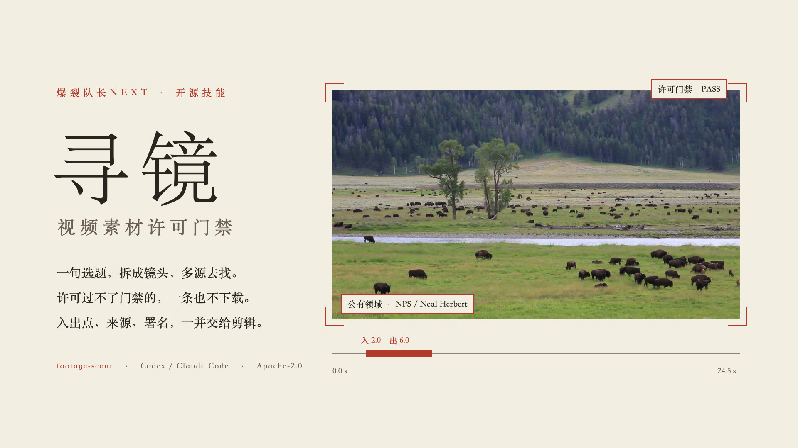
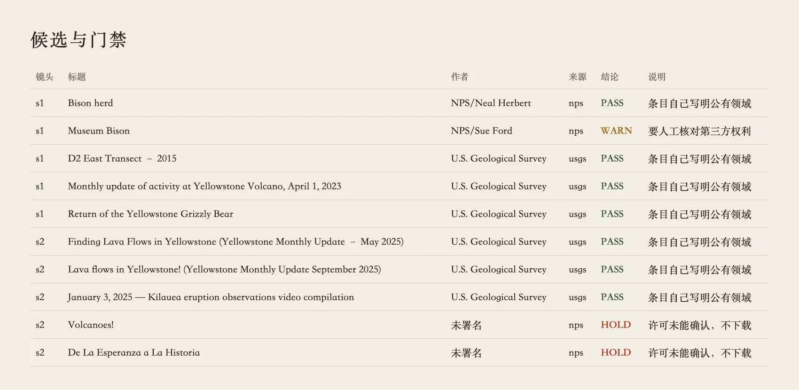
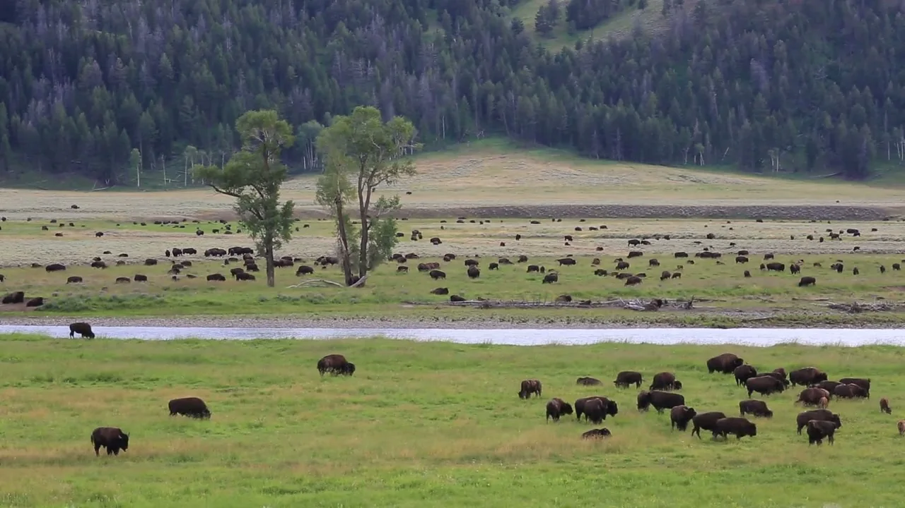

# Xunjing · Licence-Gated Video Footage

[中文](README.md) · **English**

<div align="center">
  
</div>

[](https://github.com/dososo/footage-scout/actions/workflows/ci.yml) [](LICENSE)  

> Give a topic to Codex or Claude Code and get back footage picked shot by shot: every clip passes a licence gate first, and every source and credit is on record.

`footage-scout` is BLCaptain's open-source footage skill: a command line tool, an MCP server and an Agent Skill, for Codex, Claude Code and any agent that reads `SKILL.md`. **No account, no API key.**

*Xunjing* (寻镜) means "looking for the shot". The skill text is in Chinese; commands, JSON and schemas are in English.

---

## What you get

- **Search by shot.** A topic is split into shots, and each shot goes to the sources that suit it.
- **Gate first.** Four verdicts only: PASS, WARN, HOLD, BLOCK. HOLD and BLOCK are never downloaded and there is no override.
- **Look before downloading.** Contact sheets for the agent to rate, then a stop for you to confirm items and size.
- **Mine long films.** Shot detection, in/out points, frame-accurate clips, audio removed by default.
- **Hand over to the edit.** A plan of cleared files and limits; report the changes back and the credits are rewritten.
- **Evidence.** Source page, licence, SHA-256, terms page and changes for every file.

<table>
  <tr>
    <td width="62%"></td>
    <td width="38%"></td>
  </tr>
  <tr>
    <td colspan="2" align="center"><sub>A real search and download on 2026-11-24. Frame: Bison herd, NPS/Neal Herbert, marked public domain on its source page.</sub></td>
  </tr>
</table>

The [manifest](examples/寻镜-示例/footage_manifest.json), [edit plan](examples/寻镜-示例/edit_plan.json), [edit report](examples/寻镜-示例/edit_report.json) and [credits](examples/寻镜-示例/CREDITS.md) of that run are in `examples/`. No video files are included.

---

## How it works

1. **Terms come first.** [`data/sources.yaml`](data/sources.yaml) lists 65 sources with licence, verification status and terms page. Without official terms the default is HOLD.
2. **The gate is rules, not a model.** Nine fixed rules; the agent cannot change a verdict. A page can only make it stricter.
3. **The agent looks.** It rates contact sheets from 1 to 5. A local CLIP model can rank instead; frames stay on your machine.
4. **Downloads are bound.** The confirmation token covers items and size and expires when they change; files are hashed on disk.

| Tier | How | Sources |
|---|---|---|
| T1 official interface | automatic | NASA, Internet Archive, Library of Congress, Open Beelden, Wikimedia Commons, Netflix Open Content, NASA SVS |
| T2 page reading | automatic, robots.txt on every request | ESA/Hubble, ESA/Webb, ESO, NOIRLab, ISO Republic, Dareful, NPS, USGS, NASA crew earth observations |
| T3 browser hand-off | links; you download and register | Pexels, Pixabay, Mixkit, Coverr and others, 18 in all |
| T4 entry points | search links only | Smithsonian, Europeana and others, 12 in all |

Searchable is not the same as downloadable: LOC and the NASA collection on Internet Archive are always HOLD, Dareful and NASA SVS give pages only, and on Internet Archive only Prelinger items with a declared licence are let through. Sources in T1 or T2 that are not named above are listed but have no adapter. Details (in Chinese): [方法与边界](docs/方法与边界.md).

---

## Install

You need Python 3.11+ and [uv](https://docs.astral.sh/uv/):

```bash
uv tool install "footage-scout[mcp] @ git+https://github.com/dososo/footage-scout"
```

Check the machine; it tells you what is missing and never installs anything itself:

```bash
fsc doctor
```

ffmpeg unlocks contact sheets and clips. Local ranking is the optional `vision` extra (torch, about 700 MB).

The plugin sets up the skill and the MCP server:

```bash
claude plugin marketplace add dososo/footage-scout
```

```bash
claude plugin install footage-scout@footage-scout
```

```bash
codex plugin marketplace add dososo/footage-scout
```

```bash
codex plugin add footage-scout@footage-scout
```

For the skill alone, copy the whole `skills/footage-scout` directory (also packed on the [Releases](https://github.com/dososo/footage-scout/releases) page) to `~/.agents/skills/` or `~/.codex/skills/` for Codex, `~/.claude/skills/` for Claude Code.

Not on PyPI yet. Please do not install it by name with `pip` or `uvx`: that could be someone else's package.

---

## Use

```text
Use $footage-scout to find 5 shots for a voice-over on why bison came back to Yellowstone. Commercial, landscape.
```

Or from the command line:

```bash
fsc run examples/示例选题.json -o footage
```

```bash
fsc fetch footage/candidates.json --only <asset_id>
```

That prints the size and a token; after looking at it:

```bash
fsc fetch footage/candidates.json --only <asset_id> --token <confirm_token>
```

Exit codes: 0 passed (WARN included), 1 error, 2 something is HOLD, 3 something is BLOCK, 4 environment missing. Set `FSC_CONTACT_URL` to your own public https page to enable Wikimedia Commons.

---

## Limits and privacy

- **Not legal advice.** The gate reads stated terms. WARN means you check people, trademarks and music.
- **No bypassing.** No CAPTCHAs, logins or paywalls, and no automated access where terms forbid it.
- **No platform rips.** It does not download ordinary YouTube or Bilibili videos, generate video or edit.
- **Frames stay local.** Search terms go to the sources you query. There is no telemetry.
- **Uneven coverage.** Space is strongest, then historical archives and US nature. Commercial portraits, lifestyle and Chinese local topics are weak; you get links instead.
- **Public domain does not cover personality rights.**

Latest checks (2026-11-24): CI green on 3 systems × 3 Python versions; 20 live topics with 0 licence leaks, 18/18 core topics with something downloadable but only 6/18 with a PASS for every shot. Whether the pictures fit the shots has not been rated blind by people.

---

## Author

Created and maintained by **爆裂队长NEXT (BLCaptain)**: [GitHub](https://github.com/dososo) · [@thinkszyg](https://x.com/thinkszyg) · [blteam2026@outlook.com](mailto:blteam2026@outlook.com). Feedback goes to [Issues](https://github.com/dososo/footage-scout/issues).

## License

Code, skill, data and schemas: Apache-2.0 ([LICENSE](LICENSE)). Documentation: CC BY 4.0 ([LICENSE-docs](LICENSE-docs)). Sample frame: NPS/Neal Herbert, public domain. See [NOTICE](NOTICE).
