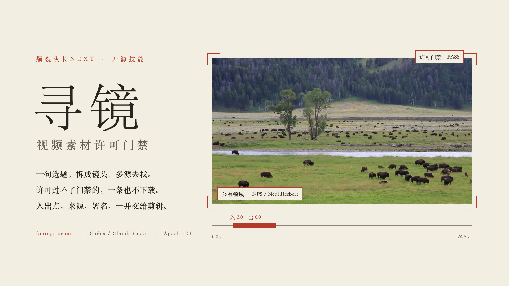
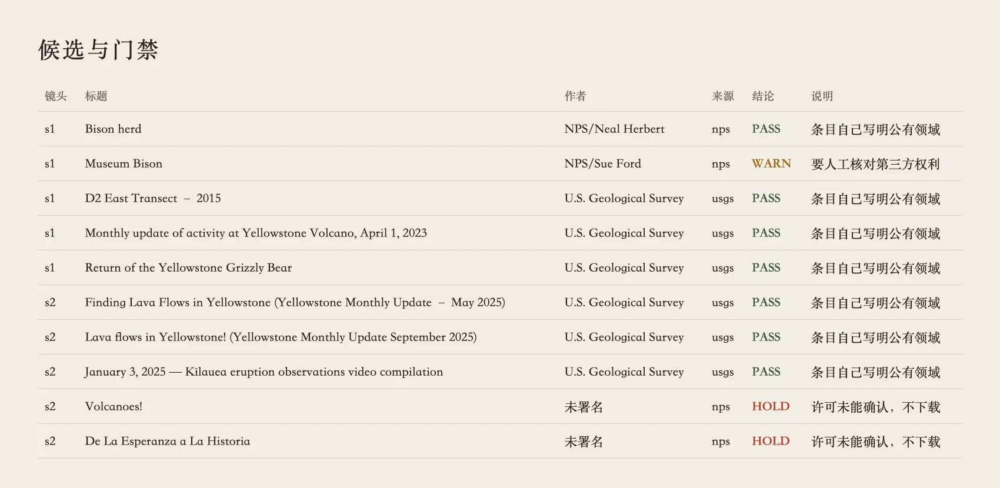
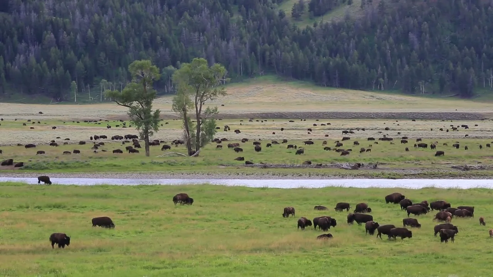

# 寻镜 · 视频素材许可门禁

**中文** · [English](README.en.md)

<div align="center">
  
</div>

[](https://github.com/dososo/footage-scout/actions/workflows/ci.yml) [](LICENSE)  

> 把选题发给 Codex 或 Claude Code，拿回一批按镜头挑好的视频素材：能不能用先过门禁，来源和署名一条不少。

`footage-scout` 是爆裂队长的开源素材技能，由命令行、MCP 服务和 Agent Skill 三部分组成，适用于 Codex、Claude Code 等能读取 `SKILL.md` 的智能体。**不注册，不要 API key。**

---

## 它给你什么

- **按镜头找。** 一句选题拆成镜头，每个镜头按题材去合适的来源检索。
- **先过门禁。** 每条素材只有四种结论：PASS、WARN、HOLD、BLOCK。HOLD 和 BLOCK 不下载，没有强制开关。
- **看过再下。** 生成拼图让智能体看画面打分，下载前停下来等你确认条目和大小。
- **从长片里挑。** 自动切镜头，给入出点，帧精度截片，默认去声。
- **交给剪辑。** 一份剪辑清单列出可用文件和限制；剪完回填改动，署名自动重写。
- **留证据。** 每个文件记来源页、许可、SHA-256、条款页地址和改动，成片署名直接可用。

<table>
  <tr>
    <td width="62%"></td>
    <td width="38%"></td>
  </tr>
  <tr>
    <td colspan="2" align="center"><sub>2026-11-24 的一次真实检索与下载。画面：Bison herd，NPS/Neal Herbert，来源页写明公有领域。</sub></td>
  </tr>
</table>

这次检索留下的[素材清单](examples/寻镜-示例/footage_manifest.json)、[剪辑清单](examples/寻镜-示例/edit_plan.json)、[剪辑回填](examples/寻镜-示例/edit_report.json)和[片尾署名](examples/寻镜-示例/CREDITS.md)都在 `examples/`，仓库不附视频文件。

---

## 怎么做到的

1. **来源表先读条款。** [`data/sources.yaml`](data/sources.yaml) 收录 65 个来源，逐个记许可、核验状态和条款页；没读到官方条款的，默认 HOLD。
2. **门禁是规则，不是模型。** 九条固定规则判结论，智能体不能改判。网页内容只能让结论更严，不能更松。
3. **智能体看画面。** 拼图给智能体打 1–5 分；也可以用本地 CLIP 模型排序，画面不出本机。
4. **下载绑凭证。** 确认码绑定条目和大小，内容变了就作废；落盘后记 SHA-256。

| 层级 | 怎么拿 | 来源 |
|---|---|---|
| T1 官方接口 | 自动 | NASA、Internet Archive、美国国会图书馆、Open Beelden、Wikimedia Commons、Netflix Open Content、NASA SVS |
| T2 读网页 | 自动，逐次遵守 robots.txt | ESA/Hubble、ESA/Webb、ESO、NOIRLab、ISO Republic、Dareful、NPS、USGS、NASA 宇航员地球观测 |
| T3 浏览器交接 | 给链接，你下载后登记 | Pexels、Pixabay、Mixkit、Coverr 等 18 个 |
| T4 检索入口 | 只给入口 | Smithsonian、Europeana 等 12 个 |

能检索不等于能下载：LOC 和 Internet Archive 的 NASA 合集许可未能核实，一律 HOLD；Dareful、NASA SVS 只给页面；Internet Archive 只放行 Prelinger 馆藏里写明许可的条目。T1、T2 里没有列出的来源已登记但没有适配器。完整规则见 [方法与边界](docs/方法与边界.md)。

---

## 安装

先装命令行（需要 Python 3.11 及以上和 [uv](https://docs.astral.sh/uv/)）：

```bash
uv tool install "footage-scout[mcp] @ git+https://github.com/dososo/footage-scout"
```

检查环境，缺什么它会告诉你怎么装，不会自己装：

```bash
fsc doctor
```

装了 ffmpeg 才能看拼图和截片；本地画面排序是可选的 `vision` 组（会装 torch，约 700 MB）。

再装技能。插件方式会同时配好 MCP：

```bash
claude plugin marketplace add dososo/footage-scout
```

```bash
claude plugin install footage-scout@footage-scout
```

```bash
codex plugin marketplace add dososo/footage-scout
```

```bash
codex plugin add footage-scout@footage-scout
```

只要技能的话，从 [Releases](https://github.com/dososo/footage-scout/releases) 下载技能包，或克隆仓库，把 `skills/footage-scout` **整个目录**复制到：

| 工具 | 安装目录 | 显式调用 |
|---|---|---|
| Codex | `~/.agents/skills/footage-scout/` 或 `~/.codex/skills/footage-scout/` | `$footage-scout` 加需求 |
| Claude Code | `~/.claude/skills/footage-scout/`，或项目内 `.claude/skills/footage-scout/` | `/footage-scout` 加需求 |

还没有发布到 PyPI。请不要用 `pip` 或 `uvx` 按名字安装，那可能是别人的包。

---

## 开始用

```text
使用 $footage-scout，给「黄石公园的野牛为什么回来了」这条口播配 5 个镜头，商用，横屏。
```

智能体会拆镜头、检索、看图，然后停下来给你一张表，等你说可以再下载。

命令行也能单独用：

```bash
fsc run examples/示例选题.json -o footage
```

```bash
fsc fetch footage/candidates.json --only <asset_id>
```

上一步给出大小和确认码，看过再下：

```bash
fsc fetch footage/candidates.json --only <asset_id> --token <confirm_token>
```

| 命令 | 做什么 |
|---|---|
| `fsc inspect footage/candidates.json` | 生成拼图 |
| `fsc score footage/candidates.json --rate s1 <asset_id> 4` | 看过拼图打分，重新排序 |
| `fsc mine footage <asset_id> --want 5` | 从长片切镜头，给入出点 |
| `fsc clip footage <asset_id> --start 10 --end 14` | 帧精度截片，默认去声 |
| `fsc links` / `fsc inbox` / `fsc register` | 只给链接的来源：出链接表、配对、登记你下载的文件 |
| `fsc edit plan footage` / `fsc edit apply footage --report edit_report.json` | 剪辑清单与改动回填 |
| `fsc credits footage/footage_manifest.json` | 片尾署名 |

退出码：0 通过（含 WARN）；1 出错；2 有 HOLD；3 有 BLOCK；4 缺环境。

MCP 单独接入用 `fsc mcp`，共九个工具。环境变量：

| 变量 | 作用 |
|---|---|
| `FSC_CONTACT_URL` | 你的公开 https 主页。Wikimedia 要求带联系方式，不设就不访问 Commons |
| `FSC_PROJECT_ROOT` | MCP 的项目根目录 |
| `FSC_INBOX` | MCP 只从这里登记你下载的文件，默认 `~/Downloads` |
| `FSC_CACHE_DIR` | 缓存目录，默认 `~/.cache/footage-scout` |

---

## 边界与隐私

- **不是法律意见。** 门禁只看写出来的条款；WARN 要你自己核对人物、商标、配乐。
- **不绕过。** 不过人机验证，不登录，不付费，不碰条款禁止自动访问的站点。
- **不下平台视频。** 不下载 YouTube、B 站等平台的普通视频，不生成视频，不做剪辑。
- **画面在本机。** 检索词会发给你选中的来源；画面分析只在本机做，没有遥测。
- **覆盖有强弱。** 太空最强，历史档案和美国自然次之；商业人像、生活方式、中文本地题材弱，会直接给你链接表。
- **公有领域不含肖像权。** 「条目写明公有领域」也可能拍到可识别的人。

---

## 本地检查

```bash
uv run --extra mcp pytest -q
```

| 检查 | 命令 | 最近一次（2026-11-24） |
|---|---|---|
| 测试 | 见上；CI 跑三系统 × 三个 Python | 九格全过 |
| 变异 | `uv run --all-extras python scripts/mutate.py` | 247/247 |
| 真实检索 | `uv run python evals/run.py --live -o out` | 20 条选题，许可泄漏 0；核心题材 18/18 有可下载素材，其中只有 6/18 每个镜头都有 PASS |
| 来源冒烟 | `uv run python scripts/smoke.py -o out` | 17 个源全部正常 |

自动测试只能证明程序按规则走，**不能证明素材选得准**；画面是否对题还没有做过人工盲评。

每周一的冒烟检查会用 PR 提交 `data/health.json`，失败或条款页变化时开 issue。健康状态只会让来源变严，连续失败四周停用。

---

## 关于作者

**寻镜** 由 **爆裂队长NEXT（BLCaptain）** 创作与维护。

- GitHub：[dososo](https://github.com/dososo)
- X / Twitter：[@thinkszyg](https://x.com/thinkszyg)
- 邮箱：[blteam2026@outlook.com](mailto:blteam2026@outlook.com)

欢迎在 [Issues](https://github.com/dososo/footage-scout/issues) 提反馈。想加来源的话，请附上官方条款页。

---

## License

- 核心库、命令行、MCP、技能、数据表与 schema：Apache-2.0（[LICENSE](LICENSE)）
- 说明文档（中英文）：CC BY 4.0（[LICENSE-docs](LICENSE-docs)）
- 示例画面：NPS/Neal Herbert，公有领域
- 许可分工见 [NOTICE](NOTICE)，依赖、字体与测试片段见 [第三方说明](docs/第三方说明.md)
